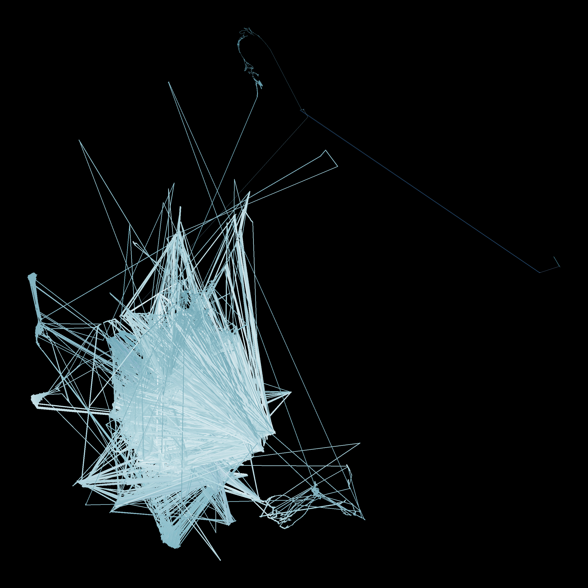
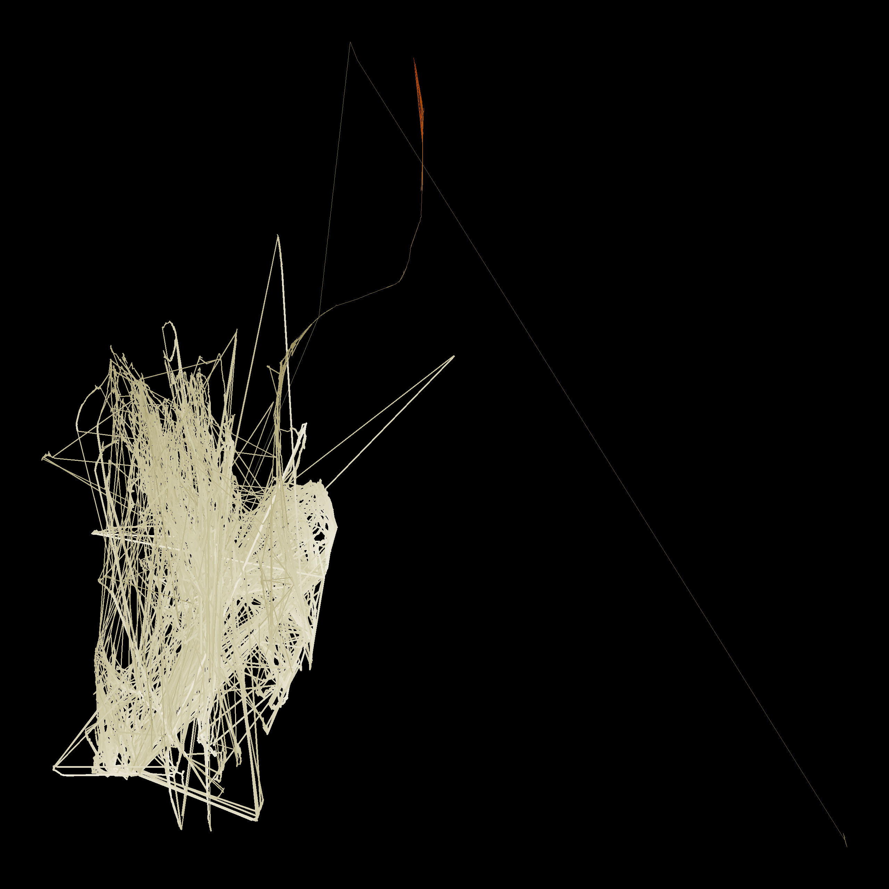
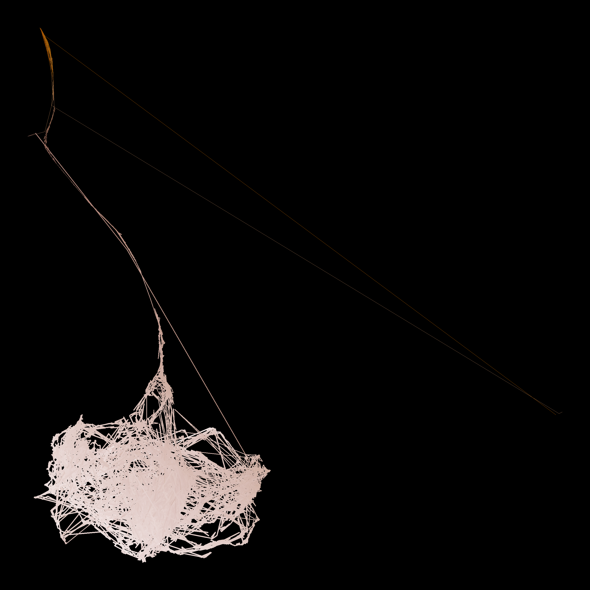
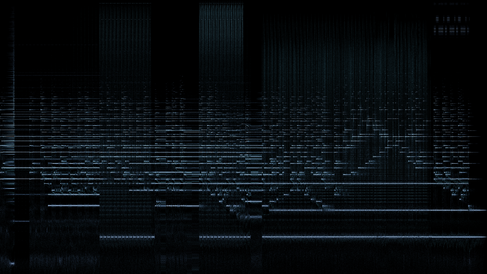

I've been wanting to make a post about music for a long time. I'm not the best writer though, but I think about music often. Specifically, I've been interested in a few pieces by Ryuichi Sakamoto. They're all unique in their own way, and at first I wanted to explore the phenomenon of his composition to describe a real object. For example, give a listen to Obsidian from Crystalline. It *sounds* like Obsidian. I don't have the words to describe how that is. So, I've tried to turn some of his songs into images. For this post, I've used these: 

- ***Amore*** — Ryuichi Sakamoto, solo piano, from *Playing the Piano* (2009)
- ***Aurora*** — Alva Noto + Ryuichi Sakamoto, from *Insen* (2005)
- ***Haru*** — Fennesz + Ryuichi Sakamoto, from *Cendre* (2007)

For context, if you haven't listened to these (highly recommend listening to them), Alva Noto is famous for a sort of glitchy, crispy sound. Fennesz has this sort of ambient, processed sound. It's hard to describe, but in Haru it is sort of like a soft wind. Amore is just piano. It is quite beautiful.

---

My piano teacher once told me about *Timbre* (apparently pronounced tam-ber), the perceived tone quality or tone color of a sound that lets you distinguish different instruments, voices, or objects even when they play the exact same pitch and volume. I think the feel of music has a lot to do with the timbre, but not of just a single instrument.

In the 1970s, John Grey tried to map the timbre of different instruments. He played pairs of instrument notes to listeners and asked them to rate how different each pair sounded. Then he arranged the instruments on a map so that the distances on the map matched the ratings. Similar-sounding instruments ended up close together. He called the result a **timbre space** (Grey, 1977). Later studies found that the directions on these maps line up with things you can measure from the audio, mainly how bright a sound is (spectral centroid) and how quickly it changes (log-attack time).

I think timbre space can be used to make images from our audio. However, we obviously do not have listeners, but need to extract features from the audio. Second, instead of points per instrument, we consider time samples, forming a path in timbre space.

---

## Step 1: Slicing the audio

A musical note isn't one frequency. Play the A above middle C and the string vibrates at 440 Hz (the *fundamental*) and also at roughly 880, 1,320, 1,760 Hz and up (the *harmonics*). The balance between those harmonics is a big part of why instruments sound different.

To see which frequencies are present at a given moment, you take a short slice of audio and run a Fourier transform (FFT) on it. the output is a spectrum: how much energy there is at each frequency.

All three tracks are first converted to mono at 48,000 samples per second. The pipeline then:

- takes a slice of 2,048 samples (about 43 ms),
- computes its spectrum,
- moves forward 1,024 samples (about 21 ms), and repeats.

That's about 47 slices per second. *Aurora* (8:52), *Amore* (5:09) and *Haru* (4:40) give roughly 52,000 slices between them.

One major tradeoff from this is that a longer slice tells pitches apart more precisely but blurs when things happened. A shorter slice does the reverse. 43 ms is an experimental middle ground: it separates frequencies about 23 Hz apart (48,000 ÷ 2,048) and still places a note's attack within a fraction of a beat.

---

## Step 2: Describing each slice with 42 elements

Each slice gets a 42-dimensional vector. 

### Where is the energy? (26-D)

**Loudness in 24 bands.** The ear doesn't treat all frequencies equally. Inside the inner ear, sound is split into overlapping bands, roughly 100 Hz wide in the bass and getting wider as you go up. About 24 of these bands cover the range of hearing; the standard numbering of them is called the Bark scale. So rather than keep the FFT's 1,025 frequency bins, the pipeline sums the energy into 24 bands spaced the way the ear spaces them.

Loudness also grows much more slowly than energy: ten times the energy sounds roughly twice as loud, not ten times. So each band's energy is compressed with a small power:

```
loudness_band = energy_band ^ 0.23
```

(0.23 is the exponent used in Zwicker's standard loudness model.) The result is 24 numbers saying how loud each region of pitch is. A bass chord lights up the low bands, a cymbal the high ones.

**Brightness (spectral centroid).** Imagine the spectrum as weights along a ruler marked in hertz. The centroid is where the ruler balances:

```
centroid = Σ f · |X(f)|  /  Σ |X(f)|
```

A trumpet or a hi-hat balances high and sounds bright. A soft, low flute balances low and sounds dark. Of everything measured here, this is the number that tracks perception most reliably.

**Spread.** How far the energy reaches either side of that balance point. A single pure tone has almost none; a wide chord or a burst of noise has a lot.

### Is it a tone or a noise? (2-D)

**Flatness.** A pure tone puts all its energy in one spike; white noise spreads it evenly. Flatness compares the geometric mean of the spectrum with its ordinary mean:

```
flatness = geometric_mean(|X|²) / arithmetic_mean(|X|²)
```

It's close to 0 for a clean tone and close to 1 for hiss.

**Roughness.** This is the one feature that needs a bit of explanation, and it's where the second paper comes in.

Tune two guitar strings almost to unison and you hear a slow wobble in volume. That's *beating*, and the wobble rate equals the difference between the two frequencies. Pull the strings further apart and the wobble speeds up until, at around 20–30 beats a second, it stops sounding like a wobble and starts sounding rough. Pull them further apart still, and the roughness fades into two clean notes.

Plomp and Levelt measured this curve with listeners (Plomp & Levelt, 1965). Two results matter here:

- **Roughness depends on how far apart two tones are relative to the ear's bands, not on the musical interval.** In the middle of the piano, two pure tones are roughest just under a semitone apart and smooth by about a minor third. In the bass, the bands are wider, so the same interval is rougher. That's why a major third sounds muddy at the bottom of the keyboard.
- **Consonance is about harmonics lining up.** For an octave or a fifth, most harmonics of the two notes land exactly together or far apart, so few pairs beat. For a minor second, lots of harmonics land close but not together, and the result sounds rough.

The code takes the 8 loudest peaks in each slice and, for every pair (28 of them), looks up how rough that pair is on Plomp and Levelt's curve, using a formula by William Sethares that fits it. The 28 values are added up. A held consonant chord scores low; a cluster of close notes or distorted guitar scores high.

This is *sensory* roughness, not dissonance in the harmony-class sense. A dominant seventh can be harmonically "dissonant" and still measure as fairly smooth.

### What just changed? (1-D)

**Flux.** How much the spectrum has gained since the previous slice. When a note is struck or a click fires, energy suddenly appears and flux spikes. During a held chord it stays low. Only increases count, so a note dying away doesn't register.

### What's the overall shape? (13 numbers)

**MFCCs.** Sing "ah" and then "ee" on the same pitch. The harmonics are at the same frequencies; what changes is the broad shape over the top of the spectrum, with some regions boosted and others scooped out. That shape is called the *spectral envelope*, and it carries a lot of an instrument's character.

MFCCs (mel-frequency cepstral coefficients) summarise that envelope in a few numbers:

1. Group the spectrum into bands on the mel scale, which, like the Bark scale, gives more room to low frequencies.
2. Take the log of each band's energy.
3. Describe the resulting curve as a sum of smooth cosine shapes, and keep the first 13 weights.

The first coefficient roughly tracks overall level and the second the tilt (bass-heavy versus treble-heavy). The rest capture finer bumps. Individually they're hard to interpret; together they're a fingerprint of the envelope. They came from speech recognition and are a standard feature for music.

### Putting them on the same scale

The centroid is measured in hertz and runs into the thousands, while flatness sits between 0 and 1. Compared raw, the centroid would drown everything else out. So every feature is rescaled across all 52,000 slices to average 0 with a typical spread of 1 (a z-score):

```
z = (x − mean) / standard_deviation
```

One side effect is worth knowing: every number now gets an equal vote. The 24 loudness bands together outvote roughness 24 to 1, so the map is shaped more by *where* the energy sits than by how rough it is.

---

## Step 3: Flattening 42 numbers onto a page

Each slice is now a list of 42 numbers. You can't draw 42 dimensions, so they have to be squashed down to 2.

I used **UMAP** (via the `umap-learn` library). You don't need its internals to use it. The intuition is:

1. For every slice, find the 30 other slices whose 42 numbers are most similar.
2. Lay all the slices out on a flat page so that those neighbours stay next to each other as much as possible.

UMAP is fitted **once** on all three tracks pooled together. That way a region of the map means the same kind of sound in every track; fitting each track separately would make the maps incomparable. The random seed is fixed, so the same input always gives the same map.

UMAP is easy to over-read. Before looking at the pictures, keep four things in mind:

- **Neighbours are meaningful.** Slices that sit close together really do sound alike, as far as these 42 numbers can tell.
- **Long distances aren't.** Two regions far apart are different, but twice as far doesn't mean twice as different.
- **Blob sizes aren't.** UMAP tends to even out density, so a large blob isn't necessarily more varied than a small one.
- **The axes mean nothing.** Up, down, left and right aren't pitch or loudness. Rotating or mirroring the map changes nothing.

---

## Step 4: Drawing and colouring the path

Each slice is joined to the next with a straight line, about 47 lines per second of music. Louder slices get thicker, brighter lines.

Colour shows three more features at once:

| Colour | Shows |
| :--- | :--- |
| Lightness | Overall loudness |
| Saturation (chroma) | Roughness |
| Hue | Brightness (spectral centroid), within a range I picked for each track |

The colours are computed in **Oklab** rather than RGB. In RGB, a yellow and a blue at the "same" settings look very different in brightness, so a plain colour ramp invents bright and dark bands that aren't in the data. Oklab is designed so that equal steps in its numbers look like equal steps to the eye, which lets lightness and hue carry different features without interfering ([Ottosson, 2020](https://bottosson.github.io/posts/oklab/)).

The hue range for each track is my aesthetic choice: cool blues for *Aurora*, a nod to the raster-noton label's design; ivory to amber for *Amore*; rose to copper for *Haru*. Within a track, hue follows brightness. The starting colours are taste, not measurement.

Finally, the image is rendered into a high-precision buffer, exposed so the brightest 0.5% of pixels hit white, passed through a filmic tone curve that rolls off highlights instead of clipping them, and saved as a 16-bit PNG.

---

## Reading the three pictures

Two rules follow directly from how the pictures are drawn:

- **Dense tangles mean the music stayed in similar sounds.** Consecutive slices land near each other, and the path scribbles over the same patch again and again.
- **Long straight lines mean a big jump between two slices only 21 ms apart.** The line is just the pen moving; nothing sounded "in between" along it.

The pictures also can't show *when* something happened. A tangle from the first minute looks the same as one from the last.

What follows is my interpretation. These are hypotheses I could check by tracing parts of each picture back to moments in the track, and I haven't done that for all of them yet.

**All three tracks** have a dense central tangle. My guess is that it's the piano: it's the sound that persists across all three pieces, and sustained piano tones produce similar slices one after another.

All three also have a faint line heading towards the top-right corner. I think that's near-silence, from fades or pauses. Silence has very unusual numbers (almost no energy anywhere), so it lands far from everything else. The lines are dim, which in this rendering means quiet, and they show up in all three tracks, as silence should on a shared map.

### Alva Noto & Ryuichi Sakamoto — *Aurora*



The central tangle is crossed by straight needles out to isolated points and back. Nicolai's part on *Insen* is built from short digital clicks and pulses. A click changes a slice abruptly: energy appears across the high bands, flux spikes and flatness rises. So the next slice lands far away, and the one after lands back near the piano. That draws exactly a there-and-back needle.

### Ryuichi Sakamoto — *Amore*



With no electronics, the tangle is more compact and layered, with fewer needles. The excursions that remain come from the playing itself: hard attacks, pedal changes and the gaps between phrases.

### Fennesz & Ryuichi Sakamoto — *Haru*



The tangle is drawn out into a funnel and a softer web, with fewer clean needles. Fennesz's processed guitar tends towards sustained noisy textures rather than isolated clicks. Noise shifts the numbers gradually (flatness and roughness rise, the high bands fill in), so the path smears across the map instead of jumping.

---

## A second picture: the reassigned spectrogram

Before throwing away the time axis, I made a more traditional picture with time left to right and pitch bottom to top, but sharpened with a technique called **reassignment** (`reassign.py`). This is the third paper, and the one part of the project that is genuinely mathematical.

In an ordinary spectrogram, each cell's energy is painted at the centre of its time slice and the centre of its frequency bin, even if the sound that caused it sat at one edge. That's why a steady tone shows up as a thick horizontal band and a click as a wide vertical smear.

Auger and Flandrin's idea (Auger & Flandrin, 1995) is to ask each cell where its energy actually came from, and move it there. The answer is hidden in the *phase* of the FFT, which ordinary spectrograms throw away. In practice, you compute the FFT four times on each slice, each with a slightly different window:

- `w(t)`, the normal window,
- `t·w(t)`, the window multiplied by time,
- `dw/dt`, its derivative,
- `t·dw/dt`, the derivative multiplied by time.

Ratios between them give a corrected time and frequency for every cell:

```
t_hat = t + Re( X_tw / X_w )
f_hat = f − Im( X_dw / X_w ) / 2π
```

A steady tone collapses to a thin line at its true pitch, and a click collapses to a thin vertical line at its true moment. Instead of a grid you get a cloud of points, millions of them per track.



### A free tone-versus-click detector

The fourth FFT gives one more number per point:

```
m = Re( X_tdw / X_w  −  X_tw · X_dw / X_w² )
```

With the windows defined as in my code, `m` comes out at −1 for a steady tone and 0 for a click; noise gives scattered values. (Papers usually write the same quantity shifted by one, as 0 for tones and 1 for clicks.) Flipping the sign and clipping to 0–1 gives a tonality score per point: 1 means tone-like, 0 means click-like. `sanity.py` checks both cases on a synthetic sine wave and click.

Summarising each track's cloud (thinned to 5 million points, with louder points more likely to be kept):

| Track | Median tonality | Points above 0.7 | Spread (IQR) | Strongest repetition in click-like points |
| :--- | :---: | :---: | :---: | :--- |
| *Amore* | 0.892 | 62.1% | 0.686 | 0.20 at 0.51 s |
| *Aurora* | 0.789 | 53.4% | 0.983 | 0.49 at 1.75 s |
| *Haru* | 0.656 | 47.4% | 0.853 | none (0.31 at the 0.05 s search floor) |

- ***Amore* is the most tone-like**, as you'd expect from solo piano.
- ***Haru* has the lowest median**, which fits its noisier sound.
- ***Aurora* has the widest spread**, partly for a boring reason: noise produces values outside the −1 to 0 range, and clipping piles them up at exactly 0 and 1. A track full of both noise and clicks therefore looks maximally spread.
- **"Repetition"** checks whether the click-like points recur on a regular cycle, by comparing their pattern with a shifted copy of itself at shifts from 0.05 to 2 seconds. *Aurora* shows a moderate peak at 1.75 s; I haven't yet checked whether that matches a pulse you can hear. *Haru* has no real rhythm in its impulses.

These are shares of reassigned points, not of time, and they lean towards the louder parts of each track.

---

## Further reading

- **Grey, J. M. (1977).** Multidimensional perceptual scaling of musical timbres. *Journal of the Acoustical Society of America*, 61(5), 1270–1277. [doi:10.1121/1.381428](https://doi.org/10.1121/1.381428)
  The original timbre space, and the reason this project is a map at all.
- **Plomp, R., & Levelt, W. J. M. (1965).** Tonal consonance and critical bandwidth. *Journal of the Acoustical Society of America*, 38(4), 548–560. [doi:10.1121/1.1909741](https://doi.org/10.1121/1.1909741)
  Why close frequencies sound rough, and why the same interval is muddier in the bass.
- **Auger, F., & Flandrin, P. (1995).** Improving the readability of time-frequency and time-scale representations by the reassignment method. *IEEE Transactions on Signal Processing*, 43(5), 1068–1089. [doi:10.1109/78.382394](https://doi.org/10.1109/78.382394)

